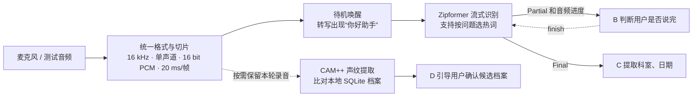
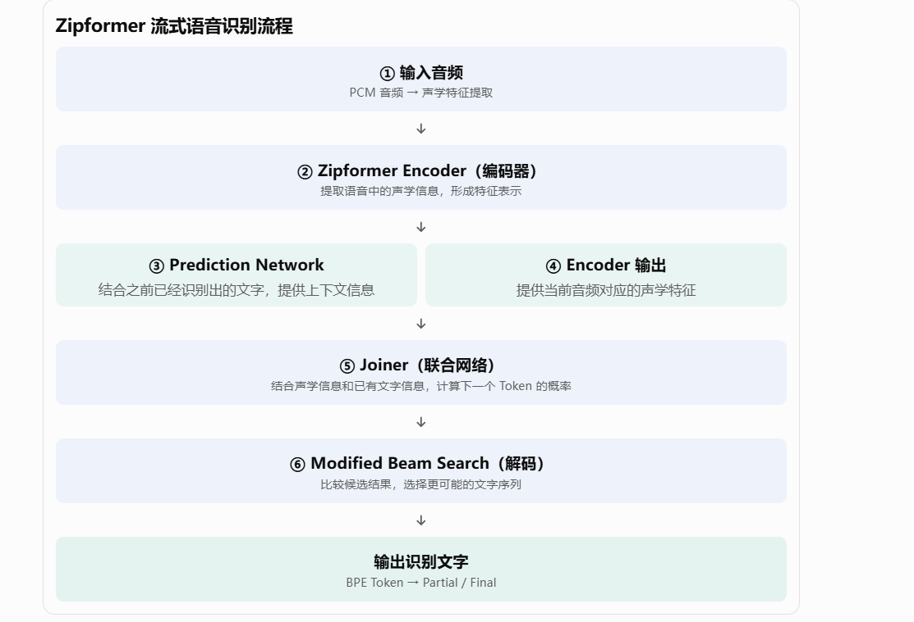

# 模块一第一阶段汇报 PPT 内容材料

---

## 第 1 页：模块一的核心功能与整体链路

### 标题

**模块一：语音输入与身份匹配核心任务**

### 核心定位

作为复诊登记助手的语音入口，模块一围绕**听清用户说的话**与**推荐身份候选**两条线，完成从音频采集到文本输出、身份候选推荐的全流程处理。

### 整体处理链路

### 四项核心任务

* **标准收音与唤醒**：把麦克风和测试录音统一成 PCM，每 20 ms 送入一帧。待机时从转写文字中找唤醒词**“你好助手”**。
* **流式语音转写**：采用 **X-ASR Zipformer INT8**，边听边输出临时文本（`Partial`），收到结束信号后收口输出最终文本（`Final`）。
* **上下文动态热词**：开启热词后，按当前问题选科室或日期词表，解码时给相关候选词加分。
* **按需声纹匹配**：用 **CAM++** 提取声纹，与本地模拟档案比对。匹配到候选后请用户确认，相似度不足或录音过短时跳过推荐。

---

## 第 2 页：核心算法——Zipformer 流式语音识别流程

### 标题

**核心识别算法：Zipformer 流式识别流程**

### 配图

**用途**　作为第 2 页主图，说明模型如何结合当前声音和已生成的词元，一边听一边更新识别文字。

### 简明流程拆解（边听边出字的核心机制）

Zipformer 采用 RNN-T 流式框架，把当前声音和已经生成的词元结合起来，边听边更新文字。

1. **声学编码（Encoder）**：应用每 20 ms 喂一帧音频，当前模型按 160 ms 分块提取声学特征。
2. **语境预测（Prediction Network）**：根据前面已经生成的词元，提供上下文信息。
3. **联合预测（Joiner）**：将当前声学特征与上下文语境融合，计算下一个候选词元（Token）的概率。
4. **束搜索解码（Modified Beam Search）**：同时比较多条转写候选。开启热词时给相关词加分，A 在识别过程中发出临时文字，收到结束信号后发出最终文字。

---

## 第 3 页：阶段实验数据与后续算法优化

### 标题

**第一阶段实验效果与后续算法优化方向**

### 阶段实现进展

本机已全流程跑通：麦克风实时采帧 · 唤醒监听 · Zipformer 流式识别 · 动态热词接入 · CAM++ 声纹匹配及模拟接口验证。

### 语音识别效果对比

测试集：同一批 **20 条清晰合成复诊录音**，共包含 **25 个科室和日期目标字段**。

|测试方案|科室/日期认对数|字符错误率 (CER)|
| --- | ---: | ---: |
|课程基线 WeNet + 热词|21 / 25|12.80%|
|**Zipformer（关热词）**|**25 / 25**|**2.37%**|
|**Zipformer（开热词）**|**25 / 25**|**2.37%**|

### 实验结论与暴露的问题

* **模型升级收益明显**：换用 X-ASR Zipformer INT8 后，解决了“下周四”听成“夏周四”等错误，目标字段由 **21/25** 升至 **25/25**，CER 由 **12.80%** 降至 **2.37%**。
* **强噪环境短板突出**：同一批录音叠加 **-5 dB 白噪声**后，目标字段正确数降至 **13/25**，嘈杂环境抗噪能力不足。
* **热词现状说明**：动态切词与解码加分机制已打通，当前合成测试中，开关热词的结果持平，两种配置在 8 条清晰普通问句中各有 1 条误识别出词表中的词。现阶段默认关闭热词。

### 下一阶段算法优化方向

1. **前端降噪与语音增强**：在音频送入流式识别前接入降噪/语音增强算法，重点提升嘈杂背景下的识别鲁棒性。
2. **热词词表与权重精调**：换用真实复诊口语语料重调词表结构与加分权重，平衡生僻词召回率与普通对话的低误触发。
3. **真人语料验证与声纹阈值校准**：补充多说话人、多语速真人录音，校准 CAM++ 声纹相似度判定阈值与流式切分边界。
