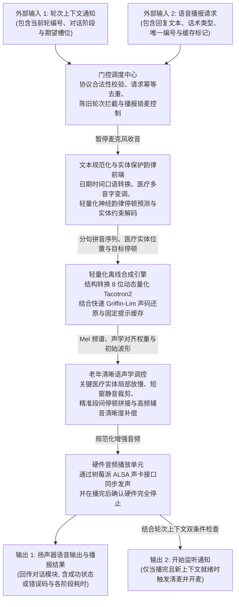

# E 模块系统设计与核心实现讲解

## 一、系统定位与整体协作流程

在离线复诊登记助手的五模块流水线中，E 模块负责承接对话管理模块输出的结构化指令，完成语音合成、硬件播报与整机收放音门控，向音频采集模块和对话管理模块反馈状态信号。整个工作流程遵循严格的事件驱动与半双工原则，具体输入、内部处理与输出关系如图所示。

从输入到输出的完整运行周期分为四个连续步骤：当对话模块发出轮次上下文通知或语音播报请求后，E 模块首先检查消息格式与版本号是否符合全组冻结规范，并依据当前轮次编号拦截延迟到达的旧轮请求；如果遇到重复编号的合法请求，则直接复用已有处理结果而不再重复发声。确认需要播报后，门控调度立即暂停麦克风采集，将文本依次送入规范化前端、轻量化合成引擎和清晰语后处理单元生成波形，再同步驱动树莓派扬声器发声。播报结束并确认播放进程彻底停止后，E 模块向对话模块回传包含合成耗时、声码耗时和音频时长的播报结果；若音频已播完且新轮次上下文已经就绪（开场问候阶段除外），系统会主动清空播报期留在声卡缓冲区的残余音频并向语音识别模块发出开始监听通知，正式进入下一轮语音采集。

## 二、五大核心功能模块与关键创新技术

**事件通信与半双工门控模块**是全组听说边界的技术落地点。全系统五个模块使用同一套单行 JSON 事件信封格式，除统一时间戳和会话编号外，E 模块还会对单目标槽位派生字段以及播报结果必需字段进行强制校验。门控内部采用四状态机管理空闲、播报中、等待新上下文和正在监听四个阶段：开麦动作必须同时满足“当前播报已停稳”和“新轮次上下文已到达”两个条件，保证每轮只会发出一次开麦指令。针对播放异常场景，硬件播放接口层会在出错时先确认停播再返回明确设备或合成错误码，让对话模块可以安全重发新请求；在树莓派部署时，只需通过设备参数指定外接 USB 声卡通道即可直接接管底层放音。

**中文文本规范化与实体保护韵律前端**解决了医疗文本声学对齐失稳与断句不自然的问题，这也是本模块的首要创新。针对门诊常见的日期（如横杠分隔年月日）、24 小时制时间、诊室编号以及中英文混杂表达，前端先通过规则转换还原为老人熟悉的中文口语习惯，并依据上下文判断补全“上午”“下午”等时段词，避免数字或符号直接送入声学模型引发对齐跑飞；同时结合分词与医疗专用多音字词典处理“一”“不”以及三声连读变调。在此基础上，模块没有沿用机械的标点或等长切分，而是利用 1 万句标准中文语音语料训练了一套仅 1.94 MB 的双向循环网络加条件随机场模型来预测三级韵律边界，并在维特比解码阶段引入医疗实体硬约束（创新点 1），禁止算法在识别出的科室、医生姓名与日期时间内部插入长停顿，从而在不破坏模型自然停顿节奏的前提下保护核心挂号语义的完整性。

**面向老年人的清晰语声学调控模块**（创新点 2）专门针对门诊噪声和老年性高频听力退化设计。常规语音合成常常语速偏快，且在高频部分能量偏弱。该模块通过计算声学模型自身生成的注意力矩阵的聚焦度和单调性，反向定位出前端标注的医疗实体所对应的 Mel 频谱帧起止位置，在不改变音高音调的前提下只对这些核心字段进行 1.18 倍速的局部时间拉伸放慢，同时让寒暄引导语维持正常节奏。为了保证多段确认信息之间的逻辑间隔可控，系统先按 10 ms 短能量窗把每小段尾部长度不确定的模型生成空白剥离干净，再精确插入 200 到 350 ms 之间的分组停顿静音；最后在音频输出前施加 2.6 kHz 的零相位峰值均衡滤波，适度增强 1.5 到 4 kHz 的辅音辨识频段能量。

**轻量化离线推理与分段流水线引擎**承担端侧高效计算任务，包含两项工程技术创新。一方面，为了在不修改原课程仓库文件的前提下适配新版深度学习运行时并提升效率，系统外挂了兼容层并重构了短时傅里叶逆变换窗函数缓存，同时用带 Nesterov 加速动量的 25 步快速 Griffin-Lim 算法替代传统的 50 步迭代声码。另一方面，由于原 Tacotron2 解码器内部采用无法直接被 PyTorch 量化接口识别的逐帧循环单元，模块创新地采用权重数值完全等价的标准多层循环模块替换原结构（创新点 3），使占全模型总参数 62.8% 的两层解码循环网络得以顺利执行动态 8 位整数量化，最终将模型体积压缩至 52.99 MB 且几乎无损音质。针对较长的多段确认句和常见问答，引擎还设计了基于生产者与消费者双线程的分段流水线并发机制（创新点 4）：主播放线程在扬声器播放第一小段的同时，后台线程并发合成并处理下一小段，显著压低了患者说出话后听到第一声回复的等待时间；而对于“请问您想约哪天”这类高频固定提示，则通过前端配置哈希自动命中本地音频缓存，实现毫秒级即时响应。

**离线评测与模拟联调验证体系**保障所有结论可复现、接口可直接合入。工程内嵌了四条完整验证路径：第一条用于原汁原味复现课程原始脚本的合成行为与指标作为对比基准；第二条在 99 句标准真实录音上自动对齐并计算动态时间规整梅尔倒谱失真（DTW-MCD），同时测试六类门诊语句在各档前端下的注意力稳定度、清晰语增益、停顿精度和流水线首音延迟；第三条独立模拟“多轮复诊登记、旧轮忽略、重复请求去重、故障停机重播与半双工开麦校验”六类整机交互场景并输出逐轮时序分析报告；第四条则是覆盖文本规范化规则、实体约束解码、局部时间拉伸等价性与状态机流转的 25 项自动化单元测试。

## 三、汇报时串讲实现的简明思路

如果在答辩时需要用半分钟快速说明代码是怎么组织的，可以按“外部进来怎么接、里面分哪几层、最后怎么安全交出去”的逻辑来口头串讲：

> “在工程实现上，我把 E 模块解耦成前后衔接的四层架构。最外层是全组共用的事件通信与半双工门控调度，负责校验对话模块发来的消息、控制播报期间锁死麦克风，并通过树莓派底层声卡驱动完成安全放音。文本进入核心合成链路后，首先经过集成日期时间规范化和 1.94 MB 轻量神经韵律模型的语言前端，依靠实体约束维特比解码把关键词语完整保护起来。接着进入完成了等价循环层 8 位量化和 25 步快速声码的 Tacotron2 推理引擎，长回复会通过双线程流水线一边播前一句一边算后一句来降低首音等待。波形出来前再经清晰语声学调控模块把关键挂号词局部放慢并增强 2.6 kHz 清晰频段，最后确认播完且下一轮上下文就绪后再发开麦信号。整条链路的各个关键算法与边界都配有自动化单元测试、客观失真评测和六类模拟联调剧本。”
